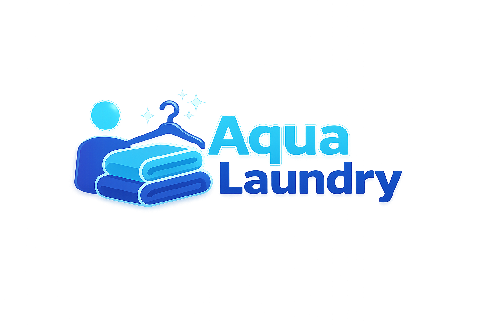

# 🧺 Aqua Laundry — Sistem Manajemen Operasional & Kasir Laundry (POS)

<p align="center">
  
</p>

<p align="center">
  <strong>Aplikasi Web Kasir & Manajemen Bisnis Laundry Modern berbasis Laravel 12</strong>
</p>

<p align="center">
  
  
  
  
  
</p>

---

## 📖 Tentang Aplikasi

**Aqua Laundry** adalah platform sistem informasi operasional dan kasir (*Point of Sale*) laundry yang dirancang untuk membantu pengelolaan bisnis laundry kiloan maupun satuan secara terstruktur, efisien, dan transparan.

Aplikasi ini mencakup pencatatan transaksi kasir, pemantauan status proses cuci hingga pengambilan pakaian, manajemen master data & tarif layanan, pencatatan pengeluaran operasional toko, serta pelaporan keuangan lengkap dengan grafik tren omset untuk pemilik bisnis.

---

## ✨ Fitur Utama

### 🔐 1. Hak Akses Berjenjang (*Multi-Role Authentication*)
- **Administrator**: Akses penuh ke seluruh sistem (Master Data Pengguna, Level, Jenis Layanan, Pengaturan Pajak, Transaksi, Pengeluaran, dan Laporan).
- **Operator (Kasir)**: Berfokus pada operasional kasir harian (Pencatatan Order Baru, Manajemen Pelanggan, Cetak Nota, dan Konfirmasi Pengambilan Cucian).
- **Pimpinan (Owner)**: Berfokus pada analitik bisnis (Grafik Tren Pendapatan 7 Hari, Ringkasan Omset Bulanan, dan Rekapitulasi Laporan Keuangan).

### 🧺 2. Operasional Kasir & Transaksi
- Pembuatan nota order baru dengan nomor faktur otomatis (`LAUNDRY-YYYYMMDD-XXXX`).
- Multi-item layanan dalam satu nota (Cuci Gosok, Hanya Cuci, Cuci Kering, dsb.).
- Pilihan waktu pembayaran fleksibel: **Bayar di Awal** atau **Bayar di Akhir (Saat Ambil)**.
- Integrasi metode pembayaran: **Tunai (Cash)**, **QRIS**, dan **Transfer Bank**.
- Fitur cetak nota struk transaksi untuk pelanggan.

### 📦 3. Manajemen Antrean & Pengambilan (*Pickup Queue*)
- Monitoring status order secara *real-time*: **Baru/Proses Cuci** vs **Sudah Diambil**.
- Deteksi batas waktu pengambilan cucian (*Overdue Alert*).
- Form validasi serah terima cucian kepada pelanggan.

### 📊 4. Analitik & Laporan Keuangan
- **Dashboard Interaktif**: Statistik harian (Order hari ini, Pendapatan hari ini, Cucian belum diambil, Tagihan tertunda/unpaid).
- **Grafik Tren Pendapatan**: Visualisasi dinamis 7 hari terakhir menggunakan *ApexCharts*.
- **Laporan Laba/Rugi**: Filter transaksi berdasarkan rentang tanggal dan metode bayar, rekap pengeluaran operasional toko, dan opsi cetak laporan fisik (*Print Friendly*).

### 🚀 5. Siap Showcase & Portofolio Klien
- **Fitur 1-Click Quick Demo Login**: Penguji atau calon klien dapat langsung masuk ke akun Admin, Kasir, atau Pimpinan dengan satu klik tanpa perlu mengetik email & password.
- **Database Seeder Realistis**: Dilengkapi data dummy pelanggan, riwayat transaksi 7 hari terakhir, dan pengeluaran toko.
- **UI Responsif Sepenuhnya**: Tampilan sidebar modern dan konten teroptimasi untuk perangkat desktop, tablet, maupun ponsel (*mobile-friendly*).

---

## 🛠️ Tech Stack & Library

- **Backend**: [Laravel 12](https://laravel.com), PHP 8.2 / 8.3
- **Frontend Template**: Mazer Admin Dashboard, Bootstrap 5.3, Bootstrap Icons
- **Database**: MySQL / MariaDB (Kompatibel dengan PostgreSQL & SQLite)
- **Visualisasi Grafik**: ApexCharts.js
- **Notifikasi & Modal**: Custom Bespoke Modal Dialog & SweetAlert2
- **Build Tool**: Vite & Tailwind CSS v4

---

## 👥 Akun Demo Bawaan (Showcase Ready)

| Role / Hak Akses | Email | Password | Akses Menu |
| :--- | :--- | :--- | :--- |
| **Administrator** | `admin@gmail.com` | `12345678` | Master Data, User, Transaksi, Laporan |
| **Operator (Kasir)** | `operator@gmail.com` | `12345678` | Order, Pelanggan, Antrean Pengambilan |
| **Pimpinan (Owner)** | `pimpinan@gmail.com` | `12345678` | Dashboard Omset & Grafik, Laporan Keuangan |

*(Dapat langsung diuji menggunakan tombol **Akses Cepat Demo (1-Klik)** di halaman login).*

---

## 🚀 Panduan Instalasi Lokal

Ikuti langkah-langkah berikut untuk menjalankan project ini di komputer lokal:

### 1. Clone Repositori
```bash
git clone https://github.com/username/aqua-laundry.git
cd aqua-laundry
```

### 2. Install Dependensi Composer
```bash
composer install
```

### 3. Konfigurasi Environment
Salin file `.env.example` menjadi `.env`:
```bash
cp .env.example .env
```
Buka file `.env` dan sesuaikan koneksi database Anda:
```env
DB_CONNECTION=mysql
DB_HOST=127.0.0.1
DB_PORT=3306
DB_DATABASE=aqua_laundry
DB_USERNAME=root
DB_PASSWORD=
```

### 4. Generate Application Key
```bash
php artisan key:generate
```

### 5. Migrasi & Seeding Data Dummy
Jalankan migrasi tabel beserta seluruh data akun demo dan data simulasi transaksi:
```bash
php artisan migrate:fresh --seed
```

### 6. Install & Build Aset Frontend
```bash
npm install
npm run build
```

### 7. Jalankan Server Lokal
```bash
php artisan serve
```
Aplikasi siap diakses melalui browser di: **`http://localhost:8000`**

---

## 📄 Lisensi

Project ini dirilis di bawah lisensi terbuka [MIT License](LICENSE).
